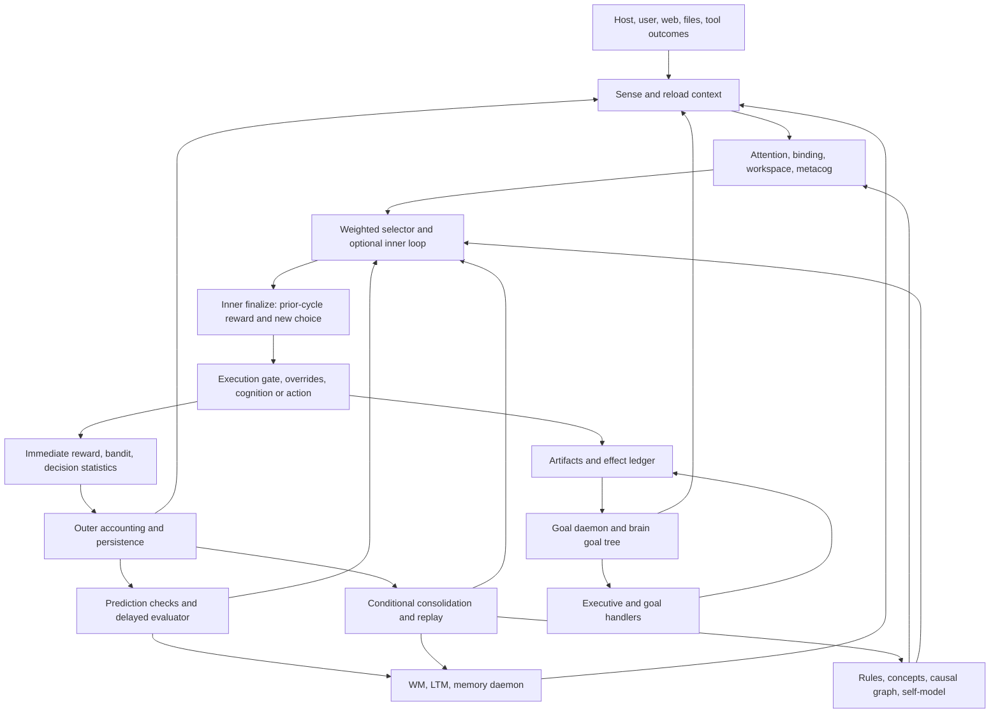

# Orrin: cognitive architecture and learning-failure investigation

**Research date:** 17 October 2026. **Source baseline:** `1c51dfb` (8 October 2026). **Latest complete archived life examined:** Run 13, 6–8 October, source baseline reported as `a6045bc`. Research only: no runtime, configuration, project source, or original experimental data was changed.

Read this report together with [the subsystem inventory](</Users/ricmassey/orrin_v3/analysis/2026-10-17-cognitive-learning-investigation/ARCHITECTURE.md>), [the chronological evidence review](</Users/ricmassey/orrin_v3/analysis/2026-10-17-cognitive-learning-investigation/CHRONOLOGY.md>), and [the experimental verification plan](</Users/ricmassey/orrin_v3/analysis/2026-10-17-cognitive-learning-investigation/EXPERIMENTS.md>). The accompanying JSON and Python files preserve the measurements and small isolated probes behind the conclusions.

## A. Executive findings

**Orrin has substantial working machinery for adaptation, but the archive does not establish a reliable autonomous learning cycle that improves performance on new problems.** The strongest explanation is a combination of faulty feedback targets, incomplete attribution, competing control rules, and insufficient task-specific representations. It is not simply that learning is absent, nor that an otherwise complete learner is being suppressed by a single regulator.

The initial hypothesis is partly supported. Goal competition, reward learning, retrieval, prediction checking, rule weakening, opinion revision, and behavioral correction are connected to execution. Historical changes to their integration produced substantial observable changes. For example, the largest goal-commitment share fell from **12,223/12,330 cycles, 99.13%, in Run 5** to **4,914/15,392, 31.93%, in Run 13**. This is evidence that the architecture can change behavior. It is not evidence that these changes arose from autonomous learning: developers changed the code between lives.

The hypothesis is also too generous in several respects. The principal action learner distinguishes only four affect buckets; it does not learn a general task-conditioned policy. The strongest grounded transfer harness is outside the normal runtime. The symbolic “experiment” runner predominantly tests whether its own reasoning machinery can produce answers, rather than whether those answers are true. A source-backed answer becoming available is frequently measured as learning without an independent behavioral test.

The highest-impact discoveries are:

1. **The system often rewards activity as goal progress.** `compute_goal_progress` credits a non-failing call, a goal-pursuit/assessment function name, and mentions of the goal. In the cognition path, `action_was_taken` is supplied as `not _is_failure`, independently of the more discriminating consequential-action accounting. With a goal present, no relevant memory, no debt, and an unrelated non-failing call, the goal-progress score is **0.9**. The goal-weighting stage converts a base reward of **0.32 into 0.668** without verified goal advancement. This is a current, directly reproduced local semantic defect in the learning target, not merely historical reward inflation. Explicit `changed=False` no-ops are now overridden to zero; that correction does not cover every ineffective call. **Confirmed.** [F1]
2. **Some learning records pair the next choice with the preceding outcome.** The inner `finalize_cycle` runs inside `think()`, before main-loop execution of the selected cognition. It consumes the previous `_step_delta_reward` but appends the new `next_function` to cognition history beside that reward. Episode replay consumes those pairs without repairing the phase relationship. Immediate execution-path bandit updates are better aligned; this is not a claim that all learning is shifted. **Confirmed execution order; magnitude of behavioral damage unknown.** [F2]
3. **A learned signal-to-function map behaves partly as a recency selector.** It normalizes multi-entry associations below one, then prunes non-current entries against a threshold of two on the next update. Even negative rewards add at least 0.1 to the current function. An isolated execution of the actual source reduces two existing associations to only the newly failed action. Run 13's retained map has one function per represented signal. **Confirmed local defect, runtime pattern consistent with it.** [F3]
4. **“An answer changed a later decision” is not what the citation instrument measures.** `annotate_reason` runs after selection, matches question-topic words to the deciding context, and annotates the already-chosen function. It does not use the answer to alter scores or the choice. Run 13 recorded **2,501 citations across 12 of 17 stored answers**, including **1,546** for the malformed “world a world” question. Current deduplication reduces repeated counts but does not make them causal evidence. **Confirmed.** [F4]
5. **Control authority is fragmented and numerically unequal.** Learned action value can influence selection, but shares authority with dozens of additive terms, attention-mode bonuses, recruitment, novelty pressure, suppression, reflex arbitration, and execution overrides. Goal tier weight is **100**, whereas the entire own-goal value range contributes at most **10**. Escape mechanisms exist and have helped; they do not ensure that a locally learned preference can change the relevant higher-level commitment. **Confirmed structure; dominance in any particular cycle requires its full score trace.** [F5]
6. **Delayed credit and replay do not supply general temporal credit assignment.** Delayed credit recognizes retrieval or a later same-goal completion; replay reinforces high-reward three-entry windows in a generic “stable” bucket. Eligibility-trace updates are explicitly a no-op. Neither mechanism establishes which earlier action caused a later useful result. **Confirmed.** [F6]
7. **Orrin really has learned some things.** Two Run 13 predictions that RSS would rise after `read_a_book` are reproducible against later, disjoint telemetry. The first used 120 training occurrences and 10 test occurrences, with test mean +9.14 MB against a +0.4631 MB baseline; the second used 262 and 10, with +32.94 against +0.0368. This is narrow predictive learning, not proof of causal identification or a subsequent resource-aware policy improvement. **Confirmed archived evidence.** [F7]
8. **A strong isolated learner is present but lacks a normal runtime route.** `grounding/world_loop.py` learns structural predictors of real subprocess outcomes and evaluates held-out commands. Tests encode a narrow transfer criterion; a June report claims successful experiments. The normal cognitive loop does not invoke that harness to generate and pursue its own learning tasks. **Confirmed code separation; historical experiment results remain report-level evidence in this investigation.** [F8]
9. **Self-generated evidence can become self-reinforcing.** Run 13's LTM snapshot contains 1,445 `summary` entries out of 2,001; a conservative direct marker test identifies 1,405 entries containing selection/metacognition/chunk/compaction text. Its causal graph contains 489 self-domain and 11 world-domain edges. These are retained-store composition measurements, not lifetime production rates. Current Phase B changes explicitly reduce self-log ingestion and favor world findings, so the historical percentages must not be assigned to the current checkout. **Confirmed historical contamination; current residual rate unknown.** [F9]
10. **Negative evidence has some real consumers, but unreliable routes remain.** Rules can be weakened and retired; opinions have deduplicated evidence and reversal thresholds. Conversely, rule-outcome matching falls back to the latest recent firing without a matching query and does not consume that WAL entry; the same firing can be rewarded repeatedly. Rule rehabilitation boosts frequently used rules, even when their grounding is weak. Run 13's retained ground-truth ledger contains 218 speech outcomes, all with empty rule IDs, and its rule-grounding map is empty. **Confirmed paths and snapshots.** [F10]
11. **Many prominently documented Run 13 faults have already received source changes.** Waiting characterization goals, unreachable follow-ups, no-op reward, impossible code-generation retries, duplicated ladder credit, rule-hit multiplication, self-log retention, and fragment extraction all have current code changes and targeted tests. There is no later complete archived life here establishing their combined effect. **Confirmed changes; system-level resolution unknown.** [F11]
12. **The present evaluation gate can pass without proving autonomous improvement.** Prediction-scored answers and structured reuse are meaningful intermediate achievements. Citation, distinct-question counts, artifact production, and a rising internal ladder still cannot substitute for better decisions on unseen tasks under a frozen implementation. **Strongly supported evaluation limitation.** [F12]

## Scope, method, and evidentiary limits

The inventory records **887 Python files, 170,847 lines, and 6,795 definitions** across the selected runtime and test trees. This is a structural inventory, not a claim that every line received equal semantic review. Investigation concentrated on the normal loop, selectors, reward producers and consumers, goal/memory bridges, prediction and rule paths, consolidation, experiments, identity, language learning, and relevant tests. Documentation was used to find historical hypotheses, then checked against source and selected raw artifacts.

Archive measurements stream JSON/JSONL, gzip, tar, and selected early ZIP snapshots. No archive was extracted into live state. Boot stamps and cycle sequences distinguish retained tails, restarts, and complete cycle logs. June ZIP duplicate files were removed by content hash before message counting. Reported “all subsystems on” run stamps are subsystem configurations, **not proof that external LLM calls were available**. The later archives contain blocked LLM calls and offline research synthesis.

Three small current-source probes execute extracted function definitions with in-memory dependencies: signal associations, rule-outcome matching, and goal-progress weighting. A fourth recomputes archived characterization statistics. They **do not import Orrin, start daemons, run a life, or establish end-to-end behavior**. Source inspection of tests establishes what they assert, not that they passed during this investigation. Historical statements about green suites are attributed to their records.

No new Orrin life, full test suite, neural training, or lengthy ablation was run. The environment offers execution tools, but doing so was unnecessary for the read-only evidence and would not honor the instruction against automatically running substantial experiments. Current combined runtime performance therefore remains unmeasured. The latest complete-life data precede the latest code.

Evidence labels used below:

- **Confirmed:** directly established by inspected code, archived raw data, or the stated isolated probe.
- **Strongly supported:** converging source and historical indicators, without a decisive end-to-end test.
- **Hypothesis:** a plausible causal explanation requiring discrimination from alternatives.
- **Unknown:** insufficient evidence, including absence of an adequate evaluation.

“Confirmed code” does not mean “confirmed dominant cause of a life.” Scores, persisted state, and reports have different evidentiary status. Counts of a retained 500-entry history or evaluator tail are never treated as whole-life totals. No consciousness or general-intelligence claim follows from the engineering terminology.

## B. Actual control architecture

The full input/output/state/consumer matrix is in [ARCHITECTURE.md](</Users/ricmassey/orrin_v3/analysis/2026-10-17-cognitive-learning-investigation/ARCHITECTURE.md>). The essential architecture is a set of concurrent loops sharing persistent stores, with a main cycle that combines their outputs. It is not one learner issuing every action.

### Execution order matters more than module names

`run_cognitive_loop` calls sensing, recall/baseline integration, health checks, workspace preparation, ignition, and `think`, followed by execution and accounting, periodic persistence, maintenance, and outer finalization. Background services run alongside this cycle. [Source: [brain/ORRIN_loop.py:run_cognitive_loop](</Users/ricmassey/orrin_v3/brain/ORRIN_loop.py:84>), [brain/loop/services.py:start_background_services](</Users/ricmassey/orrin_v3/brain/loop/services.py:24>).]

The workspace is influential but is not the sole command authority. Its winner supplies priors and routing information. `bound_goal` resolves the committed goal; it is not simply the winning workspace content. A cycle without ignition still passes through selection; quiet-cycle penalties and inner-loop withholding are graded regulation, not a complete suspension of cognition. [[brain/cognition/global_workspace.py:bound_goal](</Users/ricmassey/orrin_v3/brain/cognition/global_workspace.py:400>), [brain/loop/deliberate.py:ignite](</Users/ricmassey/orrin_v3/brain/loop/deliberate.py:125>), [brain/think/think_utils/selection/boosts.py:compute_unconscious_damp](</Users/ricmassey/orrin_v3/brain/think/think_utils/selection/boosts.py:61>).]

There are at least three distinct action routes: the deliberate cognitive choice, the Executive's procedural work, and durable goal handlers in the goals daemon. Tools have their own queues and runners. A choice appearing in cognitive history is not automatically identical to the action that produced an artifact or changed a daemon state. Execution can also substitute a health action for the selected function. Consequently, a valid learning record needs lane, actual action, decision ID, goal ID, pre-state, post-state, and outcome provenance—not just adjacent log entries.

### Which mechanisms have authority?

| Layer | Actual authority | Important limit |
|---|---|---|
| Lifespan, watchdog, resource constraints, availability and dispatch checks | Can stop execution, remove options, or redirect the cycle | Learned desirability cannot make an unavailable tool available |
| Goal tier, priority and eligibility | Establish the candidate hierarchy and driver commitment | Values operate within a heavily structured hierarchy |
| Workspace, attention, drives, recruitment | Bias scores and recruit action classes | Their outputs are not guarantees that the corresponding task is executed |
| Learned bandit values and action reward EMA | Alter candidate scores and expectations | Coarse state representation and proxy reward constrain what is learned |
| Metacognitive suppression, novelty pressure, reflexes | Can strongly alter or replace the scored preference | Escape can produce another unproductive option if alternatives lack useful affordances |
| Goal-handler and tool execution | Generate actual artifacts and external observations | Work may occur asynchronously relative to the currently logged choice |
| Narrative, citations, growth gauges | Describe or count state | Often cannot directly change a decision; must not be mistaken for control |

The implementation has meaningful cross-system consumers: causal findings can reach prediction, diagnosis and planning; opinion evidence can affect confidence and review; retrieved memories enter the context and prompts; goal credit changes commitment scores. The problem is **uneven and weakly evaluated transfer**, not universal disconnection.

## C. Learning pathways: where the loops close and where they do not

### F1 — A closed loop can optimize the wrong target

The cognition reward path is:

`execute_cognition_function` → environment snapshot difference + status + affect difference → `shape_cognition_reward` → `goal_weighted_reward` → bonuses/penalties → explicit-noop override → immediate bandit/decision statistics → next selection.

This loop is connected. Its target is problematic.

The base expression is `blend_reward(0.6*env + 0.4*status, affect)` with default affect weight 0.4. The effective weights are **0.36 environment, 0.24 status, 0.40 affect**, despite a nearby 40/20/40 comment. A non-failure status is 0.5. Flat affect supplies 0.5, giving base 0.32 even if environment reward is zero. [[brain/loop/cognition_reward.py:shape_cognition_reward](</Users/ricmassey/orrin_v3/brain/loop/cognition_reward.py:25>), [brain/think/loop_helpers.py:blend_reward](</Users/ricmassey/orrin_v3/brain/think/loop_helpers.py:70>), [brain/loop/execute.py:execute_cognition_function](</Users/ricmassey/orrin_v3/brain/loop/execute.py:174>).]

When a goal exists, 60% of this stage's reward is the goal-progress proxy. The current source gives 0.5 baseline, +0.4 for `action_was_taken`, +0.3 for `pursue_committed_goal` **or `assess_goal_progress`**, +0.1 per recent goal mention up to two, and −0.2 for debt at least three. The cognition caller passes `not _is_failure` as action taken. It does not pass the independent consequential-action flag. [[brain/cognition/planning/goal_progress.py:compute_goal_progress](</Users/ricmassey/orrin_v3/brain/cognition/planning/goal_progress.py:29>), [brain/cognition/planning/goal_progress.py:goal_weighted_reward](</Users/ricmassey/orrin_v3/brain/cognition/planning/goal_progress.py:82>).]

The isolated source probe verifies these intermediate outputs:

| Situation | Goal progress | Goal-weighted result |
|---|---:|---:|
| Unrelated non-failing cognition, goal present, no memory mention, no debt; base .32 | .90 | .668 |
| Failed cognition, same context; failure-adjusted base −.10 | .50 | .260 |

These are **stage outputs**, not predictions of every final reward. Introspection caps, repetition penalties, failure handling and explicit-noop zeroing may subsequently alter them. Nevertheless, the goal blend can erase the sign of a failure penalty, and the positive progress proxy does not require advancement of the goal's acceptance criterion.

`env_snapshot.delta_reward` itself uses milestone counts, LTM size growth, pending-tool reduction and WM changes. These are more concrete than self-rated prose, but memory growth is not truth, queue drain is not successful tool use, and a full memory store can replace content without growing. Concurrent daemon changes can also fall inside an action's measurement window. [[brain/cognition/planning/env_snapshot.py:delta_reward](</Users/ricmassey/orrin_v3/brain/cognition/planning/env_snapshot.py:336>).]

Further shaping rewards regulation under pre-existing distress, certain growth functions, value-word alignment, making attempts and other activities. Some bonuses are conditioned on novelty or decayed repetition; they are not all blind. Yet the aggregate can make a repetitive activity locally rewarding even when it does not improve task performance. Run 13 illustrates the distinction: `decide_to_write_code` recorded 273 choices and mean reward **0.62497**, with 273 blocked LLM calls in the retained activity logs. Current explicit impossible/noop handling addresses that particular case. It does not validate the overall reward target.

**Conclusion:** poor behavior need not imply failure to learn the available reward. Some of it may be competent adaptation to a misleading reward. **Confirmed target problem; “reward optimization is the dominant cause” remains a hypothesis requiring counterfactual scoring.**

### F2 — Decision/outcome alignment splits across learning channels

`think` selects the new function, updates its signal association using `context.last_reward`, and calls its inner finalizer before the main loop dispatches that function. The finalizer consumes `_step_delta_reward`, which main execution wrote after the previous selection. Its reward-engine key is ordinarily `last_function_chosen`, correctly naming the preceding function; its history entry instead names `next_function`, the newly selected function. A deliberation compression test also uses the new function against that previous reward. [[brain/think/think_module.py:think](</Users/ricmassey/orrin_v3/brain/think/think_module.py:86>), [brain/think/think_utils/finalize.py:finalize_cycle](</Users/ricmassey/orrin_v3/brain/think/think_utils/finalize.py:48>).]

This yields a split:

- Immediate execution-path bandit updates and `decision_stats` use the executed function and its current reward.
- Inner-finalizer calibration and EMA usually use the preceding function's reward, delayed by one cycle.
- Deliberate cognition history pairs a new choice with the preceding reward.
- Attention learning and rule verification at that point operate on current context with that reward.
- Episode replay learns from the mixed history without decision-ID alignment or lane filtering.

The outer finalizer stores `last_function_chosen` from the original selection result. If the execution health override replaced that function locally, the original selection can remain the next cycle's attribution key. This is a conditional mismatch, not proof it happened frequently in the archived lives. [[brain/loop/finalize.py:finalize_cycle](</Users/ricmassey/orrin_v3/brain/loop/finalize.py:123>), [brain/loop/execute.py:execute_cognition_function](</Users/ricmassey/orrin_v3/brain/loop/execute.py:174>).]

**Conclusion:** there is no single uniformly valid experience tuple shared by all learners. Some channels can be correct while replay or meta-learning receives different attribution. **Confirmed source behavior; actual learning loss unknown.**

### F3 — Association learning conflates normalized shares and reinforcement counts

`update_signal_function_map` decays stored values by .95, adds the reward clamped to at least .1, prunes non-current functions below 2, and then normalizes multi-function maps to shares capped at .5. A normalized older entry therefore cannot clear the next update's minimum count. The current function is exempt. [[brain/control_signals/signal_learning.py:update_signal_function_map](</Users/ricmassey/orrin_v3/brain/control_signals/signal_learning.py:17>), [brain/control_signals/signal_learning.py:_bound_coupling_shares](</Users/ricmassey/orrin_v3/brain/control_signals/signal_learning.py:96>).]

Executing those exact definitions against an in-memory map `{historically_good:.5, historically_bad:.5}` and a new function with reward −1 produces `{failed_action:.1}`. A different zero-reward function on the next update replaces it with `{next_action:.1}`. The selector's learned-preference normalization gives a singleton the maximum normalized preference. Thus this channel can present a recently unsuccessful choice as its strongest association.

This does not nullify the independent action EMA or contextual bandit. It creates a competing “learned” signal whose semantics are very different. Run 13's terminal map contains singleton associations for all eight non-schema signal keys, including `impasse_signal → fetch_and_read: .1`. That is consistent with the mechanism; it does not establish how much each association changed the final argmax. **Confirmed defect plus supporting snapshot.**

### F4 — Knowledge acquisition, reuse and decision influence are different events

An actual archived example begins with the question about emergence in complex systems. The daemon's `g_e62c0425a7/claims.json`, timestamped **2026-10-06 20:01:15 UTC**, contains extracted web relations, including the definition of a complex system. Its memo explicitly identifies itself as offline stitched excerpts. `answered_questions.json` stores that definition and eventually records 288 citations.

The actual path is:

1. Intrinsic/research goal and queries → daemon research handler.
2. Search/fetch → snippets → extracted relations plus memo and source references.
3. Epistemic closeout → answered stamp, answer index, growth event, possible follow-up.
4. Later research can read a prior claims file, insert its relations into synthesis, and record a reuse effect.
5. Later selection can annotate a reason if question terms overlap its context.

Steps 1–4 represent real acquisition and reuse opportunities. Step 5 does **not** demonstrate a changed decision: `annotate_reason` receives `chosen`, appends a citation, and logs a causal-sounding message after selection. It matches the **question's subject**, not an inference made from the answer. [[goals/handlers/research.py:_find_prior_claims](</Users/ricmassey/orrin_v3/goals/handlers/research.py:111>), [goals/handlers/research.py:ResearchHandler](</Users/ricmassey/orrin_v3/goals/handlers/research.py:164>), [brain/cognition/epistemic_closeout.py:stamp_closeout](</Users/ricmassey/orrin_v3/brain/cognition/epistemic_closeout.py:364>), [brain/cognition/answer_citation.py:annotate_reason](</Users/ricmassey/orrin_v3/brain/cognition/answer_citation.py:82>).]

The same distinction applies to Run 13's 833 reuse rows. **114** have a `citing_goal_id`; **105 of those reference `claims.json`**. Reading a prior claim is stronger evidence than an unattributed file read, but it does not show that the new answer is correct, more informative, or useful in a changed setting. The report-level “110” reuse count uses a different qualification; it should not replace these explicit denominators without reproducing that qualification.

Current `score_answer_structured` checks subject overlap, relation novelty against prior claims, and special treatment of revision-shaped questions. A resolved correct telemetry prediction is a separate success route. These are substantial safeguards. For ordinary research questions, however, no independent truth or application test follows from a new matching relation. A misconception phrase can also qualify without establishing that Orrin previously held the corrected belief. [[brain/cognition/epistemic_closeout.py:score_answer_structured](</Users/ricmassey/orrin_v3/brain/cognition/epistemic_closeout.py:219>).]

Run 13 provides counterexamples: an answer about game-playing AI points to role-playing video games, and a consciousness answer points to religious experience. Current chrome/topic filters address some extraction errors; broader semantic sufficiency remains unproven.

**Conclusion:** Orrin can acquire and carry information forward. The archive's citation metric overstates evidence that this information controls decisions. **Confirmed distinction; usefulness of individual reused claims must be evaluated separately.**

### F6 — Delayed credit and replay are partial closure mechanisms

The delayed evaluator's retrieval branch rewards a later retrieval carrying the originating decision ID, within its cycle window. The goal branch rewards a later completion of the same goal when a qualifying effect exists, with effect significance scaling the reward. These mechanisms connect persistence to later events. They do not establish that retrieved material was useful or that a particular earlier decision caused completion. A pending decision resolves on the first eligible event; early retrieval can preclude later goal-outcome evaluation. Old pending decisions are pruned without an equivalent failure-learning signal. [[brain/eval/evaluator_daemon.py:EvaluatorDaemon](</Users/ricmassey/orrin_v3/brain/eval/evaluator_daemon.py:33>).]

Run 13's retained evaluator snapshot has 501 pending rows and the last 500 resolved rows: **414 pruned, 79 goal-grounded, 7 retrieval-based**. This is evidence about the retained tail, not an 82.8% lifetime prune rate.

Replay uses overlapping three-entry windows whose mean reward is at least .65. It gives each member a discounted window-average reward at learning rate .04, using only `replay` and bias features. Those map to the stable affect bucket. Original task state, uncertainty, action arguments and goal identity are not restored. The same historical windows can be replayed again; pair counts can double-count transitions across overlapping windows. Stored chain strength uses `max(existing_count, count)`, with a bonus up to .30 and no negative revision in this path. [[brain/cognition/idle_consolidation/episode_replay.py:run_episode_replay](</Users/ricmassey/orrin_v3/brain/cognition/idle_consolidation/episode_replay.py:26>), [brain/think/bandit/contextual_bandit.py:_context_bucket](</Users/ricmassey/orrin_v3/brain/think/bandit/contextual_bandit.py:56>).]

Run 13 stores `research_topic → research_topic` with count 55 and bonus .30, and `leave_note → leave_note` with count 9 and bonus .30. The existence of repetition-promoting chains is confirmed. Whether removing them improves external outcomes is a hypothesis, not an observed ablation result.

`step_traces` is explicitly a compatibility no-op. The tabular bandit updates action values; it is not a functioning TD(λ) learner despite surrounding historical terminology. Delayed updates, replay and live observations also contribute to counts used for confidence/exploration, despite not being independent experiences. **Confirmed design limitation.**

### F7 — A genuinely closed prediction loop, with a missing policy demonstration

`CharacterizeHandler` hypothesizes from at least 300 telemetry rows, restricts drivers to at least 30 occurrences, and checks only samples after the hypothesis cutoff. A driver requires at least 10 fresh occurrences. Its tested proposition is “the mean subsequent metric rise exceeds the fresh baseline.” [[goals/handlers/characterize.py:hypothesize](</Users/ricmassey/orrin_v3/goals/handlers/characterize.py:97>), [goals/handlers/characterize.py:test_hypothesis](</Users/ricmassey/orrin_v3/goals/handlers/characterize.py:107>).]

The independent recomputation in `probe_results.json` exactly reproduces the training counts and means for all three Run 13 claims. For both successful RSS claims, it finds a disjoint fresh prefix exactly matching the archived test count, mean and baseline:

| Goal | Hypothesis time UTC | Training | Matching fresh prefix | Test result |
|---|---|---|---|---|
| `g_8defcfaea8` | Oct 6, 21:55:04 | 120 `read_a_book` occurrences; +74.1325 MB vs +.2805 baseline | 1,173 rows after cutoff, 10 driver occurrences | +9.14 MB vs +.4631 |
| `g_d4163f89bf` | Oct 7, 14:45:02 | 262 occurrences; +35.8844 MB vs +.0551 | 1,101 rows after cutoff, 10 driver occurrences | +32.94 MB vs +.0368 |
| `g_b365f032d2` | Oct 6, 22:25:12 | 144 generator occurrences; CPU +.0382 vs +.0003 | Archived outcome: insufficient recurrence within wait | Inconclusive, encoded `correct:false` |

The final archive extends beyond the check; the prefix matching validates the test sample's existence and statistics, not an independently recorded exact check instant. The second RSS training set contains earlier life experience, including the first experiment's era; these are not two independent task families.

This is **observed hypothesis formation, a future-data check, and retained knowledge**. It remains observational: asynchronous work, elapsed time and GC can affect RSS. No randomized intervention or uncertainty interval is used. More importantly, this report found no controlled demonstration that the resulting answer reduced later resource use while preserving task success. The learning cycle reaches a checked prediction; its behavioral improvement leg is unestablished.

### F10 — Belief correction exists, but evidence identity is unreliable in places

Rules have mutable confidence, miss streaks, authority decay and consolidation-time revision draining. The archive contains weakened and tombstoned rules. Opinions distinguish mention/salience from evidence, deduplicate `(kind, ref_id)`, adjust alpha/beta confidence, and can drop a belief when grounded counterevidence clears its stake-scaled threshold. This is important contradictory evidence against the claim that Orrin cannot revise beliefs at all. [[brain/symbolic/rule_verifier.py:_adjust_confidence](</Users/ricmassey/orrin_v3/brain/symbolic/rule_verifier.py:199>), [brain/symbolic/rule_verifier.py:drain_revisions](</Users/ricmassey/orrin_v3/brain/symbolic/rule_verifier.py:350>), [brain/cognition/opinions_store.py:add_evidence](</Users/ricmassey/orrin_v3/brain/cognition/opinions_store.py:264>), [brain/cognition/opinions_store.py:_should_flip](</Users/ricmassey/orrin_v3/brain/cognition/opinions_store.py:364>).]

However, `rule_verifier.apply_outcome` uses the latest recent unfilled firing if no exact query match exists. It never marks that firing's `outcome` as consumed. An isolated matching probe supplies one firing and two unrelated high outcomes; the actual function requests two confidence rewards for the old rule. Its optional pattern update then treats the same proxy score as success evidence. This can create repeated or unrelated confidence updates. It does not invalidate the separate prediction-miss route, which can name a specific rule.

The symbolic autonomous experiment has another attribution hole: successful routed answers put `query`, `source`, and `answer` into its evidence list, omitting `rule_id`; its low-hit-rate revision branch later looks for `evidence.rule_id`. That branch cannot penalize those rule IDs from its own ordinary result format. More fundamentally, its success condition is internal symbolic coverage, not an independently observed truth. [[brain/symbolic/autonomous_experiment.py:run_sandbox_experiment](</Users/ricmassey/orrin_v3/brain/symbolic/autonomous_experiment.py:115>), [brain/symbolic/autonomous_experiment.py:_apply_rule_revision](</Users/ricmassey/orrin_v3/brain/symbolic/autonomous_experiment.py:195>).]

Finally, self-improvement rehabilitation rewards hit counts when confidence is low; its boost remains positive even at grounding zero. Meta-rule promotion uses application share. Router calibration generates proposals rather than changing routing thresholds, although the returned summary counts them as calibrations. Run 13's self-improvement log contains repeated PLANNING calibration proposals; its retained ground-truth ledger has no populated rule IDs. These facts limit the claim that outcome-informed self-improvement has reliable authority. [[brain/symbolic/self_improvement.py:_rule_rehabilitation](</Users/ricmassey/orrin_v3/brain/symbolic/self_improvement.py:85>), [brain/symbolic/self_improvement.py:_router_calibration](</Users/ricmassey/orrin_v3/brain/symbolic/self_improvement.py:150>), [brain/symbolic/self_improvement.py:_meta_rule_pruning](</Users/ricmassey/orrin_v3/brain/symbolic/self_improvement.py:201>).]

There is also a concrete persistence conflict in self-belief revision. `goal_belief._revise_weak_area_beliefs` writes a **dictionary keyed by domain** to `SELF_BELIEF_REVISIONS_FILE`. `reflect_on_self_beliefs` treats the same path as a **list of reflection events**, resets a non-list to `[]`, and saves that list; the goal writer likewise resets a non-dictionary. Whichever path writes next can discard the other's schema. Furthermore, `build_symbolic_self_model` recomputes weak areas from domain quality without reading this revision ledger, despite the goal writer's comment that the ledger prevents a later rebuild from reinstating the belief. Other domain-credit effects may independently alter quality, so reinstatement is conditional. Run 13 retains a domain dictionary with repeated zero-confidence COGNITIVE revision events, consistent with recurring weak-area classification; it does not prove the list/dictionary overwrite happened in that life. **Confirmed schema/consumer mismatch; historical erasure frequency unknown.** [[brain/cognition/planning/goal_belief.py:_revise_weak_area_beliefs](</Users/ricmassey/orrin_v3/brain/cognition/planning/goal_belief.py:53>), [brain/cognition/reflection/reflect_on_self_belief.py:reflect_on_self_beliefs](</Users/ricmassey/orrin_v3/brain/cognition/reflection/reflect_on_self_belief.py:106>), [brain/symbolic/symbolic_self_model.py:build_symbolic_self_model](</Users/ricmassey/orrin_v3/brain/symbolic/symbolic_self_model.py:100>), [brain/paths.py](</Users/ricmassey/orrin_v3/brain/paths.py>).]

## D. Historical behavioral analysis

[CHRONOLOGY.md](</Users/ricmassey/orrin_v3/analysis/2026-10-17-cognitive-learning-investigation/CHRONOLOGY.md>) gives the dated sequence, expectations, measured outcomes, change links and remaining uncertainty. The broad pattern is **real engineering progress without a corresponding controlled demonstration of autonomous competence growth**.

Early June snapshots show frequent low-reward diversive actions despite better-valued research. June 25 shows a single abstract goal occupying 82.39% of cycles. July added increasingly concrete artifact and goal-effect accounting, but exposed timestamp novelty pumps, goal-value saturation and one-member commitment pools. July 15's aspiration-pool correction coincided with the large decline in commitment monopoly. July–August introduced better epistemic products and checks, while later evidence exposed malformed answers, weak reuse attribution and feeding gaps. Run 13 finally supplies independently reproducible future-data predictions, but also large amounts of no-op research selection and self-generated memory.

A recurring pattern is a repaired symptom followed by the same failure at another boundary: novelty pumping moved from duplicate prose to low-quality novel output; retirement pressure existed but had few alternative commitments; richer research goals exposed an execution handoff failure; checked telemetry goals entered the foreground commitment slot while waiting for data. These are distinct failures, not proof that every earlier correction was ineffective.

The October 8 changes target these specific boundaries. The correct present-tense claim is **“changed in current source; targeted tests exist; combined full-life outcome unknown,”** not “still broken exactly as Run 13” or “resolved because tests were added.”

## E. Learning suppression and subsystem interference

### F5 — Numerical competition constrains the effective policy

The selector's base weights include directive .22, goal .22, emotion .26, novelty .10, bandit .25 and drive .15. Mature actions gain an additional value term `.6*(EMA-.5)`, normally between −.3 and +.3 for a [0,1] EMA. Some exploration terms are capped after eight observations, and positive totals are scaled by `.5+EMA`. These are genuine attempts to let outcomes matter. [[brain/config/tuning.py](</Users/ricmassey/orrin_v3/brain/config/tuning.py>), [brain/think/think_utils/selection/score_actions.py:score_candidates](</Users/ricmassey/orrin_v3/brain/think/think_utils/selection/score_actions.py:148>).]

But other terms are not all inside that cap: workspace routing up to .35, goal lens up to .36, chain bonus up to .30, alert-mode function boost .42, wandering outward boost .25, type recruitment .20, forced action .30, active value-revision tension .60, and metacognitive novelty pressure up to 1.5 times novelty. Suppression and multiplicative repetition corrections follow. Different terms apply in different states; summing all their maxima would be a misleading hypothetical score.

Two conclusions follow directly. First, a learned disadvantage of a few tenths can be outweighed by ordinary control terms. Second, the architecture cannot be characterized as a bandit with occasional safety checks: its weighted controller is the policy, with learning as several inputs. The source even computes an `exploit` diagnostic that is not included in the total; a displayed component is not necessarily an active contribution.

At the goal level, `commit_score` uses **100×tier + 10×priority**, learned value **10×(value−.5)**, stale and avoidance penalties up to 15 each, neglect up to 13, and incumbent bonus 2. A one-tier difference exceeds the normal combined adaptive score movement. Eligibility blocks and refractory release can cross that barrier by removing a goal, but low value alone cannot. [[brain/cognition/planning/commitment_value.py:commit_score](</Users/ricmassey/orrin_v3/brain/cognition/planning/commitment_value.py:344>), [brain/cognition/planning/commitment_value.py:note_driver_selected](</Users/ricmassey/orrin_v3/brain/cognition/planning/commitment_value.py:142>).]

**Assessment:** control competition is strongly supported as a recurring mechanism. A claim that fixed priorities always overpower learning is false: historical rotation and current value-sensitive scoring contradict it. The necessary next evidence is per-decision score attribution and controlled removal of one influence at a time.

### Recognition can work while correction remains ineffective

Metacognition detects ruts, oscillation, avoidance and stalled steps. It does more than write observations: it can suppress functions, force action-class pressure, suppress goal deliberation/generation, raise novelty, and increase a goal's avoidance penalty. Structural watchdogs are not silenced by the monitor's dismissal recalibration. [[brain/cognition/metacog.py](</Users/ricmassey/orrin_v3/brain/cognition/metacog.py>), [brain/cognition/behavioral_adaptation.py:apply_behavioral_adaptations](</Users/ricmassey/orrin_v3/brain/cognition/behavioral_adaptation.py:133>).]

Nevertheless, “force action” means a selected action class, not a guaranteed externally useful operation. The class includes functions that create or plan goals. Novelty pressure can substitute a fresh low-value action for an old one. Learned monitor quieting uses whether a breakthrough was honored, not whether honoring it would have improved the external outcome. A controller that habitually ignores a useful soft warning may consequently reduce that warning's future influence. This last harmful feedback is a **hypothesis**, because monitor honor/dismiss traces need outcome-conditioned analysis.

Escape is also constrained by the alternative set. Historical Run 7 had much less credit inflation but still a ~91% dominant commitment; broadening the aspiration pool in Run 8 produced far greater rotation. That supports an integration explanation rather than a claim that a new abandonment faculty was missing.

### F9 — Memory, appraisal and replay can amplify the same evidence

Memory retrieval reinforces returned candidates before final mood reranking and private filtering. Under mood reranking, salience and strength replace the original semantic ordering within the retrieved pool. Injection adds goal-lens relevance, but if a query returns nothing, existing retrieved context can persist. These mechanisms support continuity and affect-sensitive recall, while also allowing already-strong material to become stronger without proving useful use. [[brain/memory_io.py:query](</Users/ricmassey/orrin_v3/brain/memory_io.py:154>), [brain/memory_io.py:inject_into_context](</Users/ricmassey/orrin_v3/brain/memory_io.py:200>), [memory/retrieval.py:retrieve](</Users/ricmassey/orrin_v3/memory/retrieval.py:142>).]

Historically, internal observations entered WM, were chunked into LTM, were recalled as salient state, and could trigger appraisal, causal extraction and further internal observations. Repeated textual mentions also increase confidence in the text-derived world model. This is a route by which narration can be mistaken for corroboration. Current B1–B3 changes restrict self-log ingestion/appraisal and alter retention; their existence is material counterevidence against treating the historical loop as untouched.

Replay adds another reinforcing route: favorable proxy rewards can preserve repeated action pairs, while fast association pruning discards alternatives and slow symbolic forgetting leaves frequently fired rules intact. Rule idle decay starts after 21 days; staged lives are roughly one day, although some rule state persists across lives. Slow forgetting is not inherently wrong. It is poorly matched to a within-life rut if no separate fast outcome route successfully corrects that rut.

### Regulation and learning operate on different clocks

Affect restores toward baselines, receives appraisal and queued pumps, then undergoes velocity/refractory processing, clamps and chronic-distress drains. Reward, workspace writeback, inhibition and demand can all contribute. Per-cycle controls coexist with wall-clock cooldowns, daemon ticks, delayed windows and consolidation. Current time-accounting changes recognize suspension, but do not turn every learning window into one coherent elapsed-time model. [[brain/control_signals/update_signal_state.py:update_signal_state](</Users/ricmassey/orrin_v3/brain/control_signals/update_signal_state.py:84>), [brain/control_signals/homeostasis.py](</Users/ricmassey/orrin_v3/brain/control_signals/homeostasis.py>), [brain/loop/maintenance.py](</Users/ricmassey/orrin_v3/brain/loop/maintenance.py>).]

The resource-cost learner is a positive example of meaningful numerical coupling: observed latency updates cost estimates; EVC contributes a bounded selection penalty up to .20, discounted by payoff. Yet if payoff is inflated by proxy rewards, expensive unproductive actions can appear worth their cost. Conversely, expensive exploration may be disfavored before its delayed benefit arrives. Neither effect's net size is established from the available archive. [[brain/cognition/cost_prediction.py:record_cost](</Users/ricmassey/orrin_v3/brain/cognition/cost_prediction.py:118>), [brain/cognition/cost_prediction.py:evc_selection_adjust](</Users/ricmassey/orrin_v3/brain/cognition/cost_prediction.py:191>).]

## F. Capabilities present, insufficient, and unestablished

### Operational definition

Autonomous learning here means that, under a frozen implementation and without an operator supplying each next step, Orrin chooses or encounters an uncertain task, gathers informative evidence, changes a persistent representation or strategy because of that evidence, and subsequently performs better on independently scored situations that are not mere repeats. Retention and robustness to contrary evidence are part of the claim. File growth, successful execution, confidence, introspective language and accumulated internal reward are insufficient by themselves.

| Required step | Implemented and connected? | Observed evidence | Capability judgment |
|---|---|---|---|
| Encounter an unfamiliar problem | User input, research topics, host changes, novelty and knowledge gaps feed goals | External pages and telemetry variations in archives | Demonstrated encounter; “unfamiliar” requires a baseline knowledge audit |
| Recognize a gap | Prediction error, coverage, epistemic questions, uncertainty and metacog | Unanswered-question records and research goals | Demonstrated mechanically; gap quality often weak |
| Decide to investigate | Intrinsic generators, feed, commitment and handler handoff | Autonomous research artifacts; historical feed starvation | Demonstrated conditionally, not reliably continuous |
| Acquire relevant information | Search/fetch, files, tools and memory | Sourced claims and memos | Demonstrated, with relevance/extraction failures |
| Form a testable hypothesis | Characterization, symbolic prediction; optional open-vocabulary experimentation | Three Run 13 characterization claims | Demonstrated in a narrow template family |
| Test against evidence | Future telemetry; subprocess harness; prediction checks | Two RSS checks independently reproduced | Demonstrated narrowly; many “experiments” use internal coverage instead |
| Revise belief/rule/strategy | Rule penalties, opinion evidence, bandit/EMA, goal values | Tombstones, changed confidence, learned reward statistics | State revision demonstrated; validity depends on evidence attribution |
| Retain revision | JSON/WAL/checkpoints and retrieval | Persisted rules, claims, values and weights | Demonstrated persistence; selective forgetting and resets complicate continuity |
| Apply to a meaningfully different situation | Analogies/causal planning and isolated structural transfer harness | Harness report; runtime reuse/citation records | Runtime transfer of a learned solution not established by these records |
| Improve future performance | No adequate end-to-end controlled record located | Engineering changes improve some runtime distributions | Autonomous competence improvement remains unknown |

### What is genuinely insufficient?

1. **Task-conditioned decision learning.** The principal bandit indexes action by one of four affect buckets. Arbitrary extracted features do not make its learned value task-specific. This is an expressiveness limit of that learner, even though symbolic routing elsewhere uses more context. It cannot by itself learn “use method A for this problem structure, B for another” unless those distinctions reach another effective controller. **Confirmed local limitation, not proof that a new subsystem is necessary.**
2. **General executable epistemic tasks in symbolic-only operation.** The strongest live empirical task is a fixed telemetry characterization template. The broad experiment pipeline requires an LLM-callable configuration; the symbolic fallback probes its own coverage. The standalone grounded-concept learner is not connected as an autonomous investigation policy. **Confirmed incomplete capability.**
3. **Reliable experience provenance across learners.** Delayed goal matching, generic cycle rewards, history phase mismatch and empty rule attribution do not form a dependable shared action→evidence→revision chain. Some channels already carry IDs, so this is principally an integration/defect issue, not absence of all provenance machinery. **Confirmed insufficiency.**
4. **Semantic answer and strategy validation.** Topic overlap plus novel extracted relation is not a general test of explanation quality, contradiction resolution or useful application. Narrow external tests exist, but no general guarantee does. **Confirmed limitation of current checks; broader solution is a research problem.**
5. **Continual-learning evaluation.** There is no demonstrated repeated-task/novel-task evaluation matrix isolating experience from developer intervention, warm-start knowledge, changing tools or different runtime budgets. **Unknown capability because evidence is missing.**

These are not arguments for adding five components. Existing mechanisms could plausibly satisfy much more of the operational definition if their outputs were aligned and evaluated together. Some restrictions may be addressed by connecting existing representations; whether they suffice for broader transfer cannot be settled by reading code.

### Can Orrin improve its learning strategy?

There are implemented meta-adaptations: threshold-arm selection in `meta_controller`, inner-loop depth allocation, goal-pursuit depth, calibration bias, attention weights, monitor-kind recalibration, rule rehabilitation and meta-rule priorities. Run 13's four threshold arms have thousands of updates with average proxy rewards around .556–.564. This is stateful meta-selection, not proof that learning becomes more efficient on new tasks.

The inner-loop depth learner is particularly limited as evidence: the feedback uses self-reflected quality/confidence plus an efficiency bonus, and records `round_num` actually used rather than necessarily the originally allocated arm. Its update occurs before the outer task outcome. The goal-pursuit depth path separately receives execution feedback and should not be conflated with it. [[brain/think/inner_loop.py:run_inner_loop](</Users/ricmassey/orrin_v3/brain/think/inner_loop.py:287>), [brain/think/depth_bandit.py:record_outcome](</Users/ricmassey/orrin_v3/brain/think/depth_bandit.py:91>), [brain/cognition/planning/thinking_depth.py](</Users/ricmassey/orrin_v3/brain/cognition/planning/thinking_depth.py>).]

The appropriate verdict is **implemented and partly observed meta-adaptation; autonomous improvement of the learning strategy is unproven**. A useful test measures later external success per observation or unit cost, not whether threshold files changed.

## Research comparison

These comparisons illuminate mechanisms. They do not confer scientific validation on Orrin.

| Research | Established result or framework | Relevant inference for Orrin |
|---|---|---|
| [Lopez-Paz & Ranzato, 2017, Gradient Episodic Memory](https://arxiv.org/abs/1706.08840) | Continual learning can be evaluated with task accuracy and transfer across a sequence of tasks | Orrin needs retention and forward/backward transfer measurements; internal growth counters do not supply them |
| [Ng, Harada & Russell, 1999, reward shaping](https://people.eecs.berkeley.edu/~pabbeel/cs287-fa09/readings/NgHaradaRussell-shaping-ICML1999.pdf) | In the stated MDP setting, potential-based shaping preserves optimal policies under specified conditions; arbitrary shaping need not | Orrin's activity bonuses have no shown policy-invariance property. This motivates testing reward alignment, not mechanically applying the theorem to its nonstationary controller |
| [Sutton, Precup & Singh, 1999, options](https://www.sciencedirect.com/science/article/pii/S0004370299000521) | Temporally extended policies can have initiation, execution, termination and value-learning structure | Orrin's goals resemble temporal abstractions, but separate commitment, handler completion and function values do not automatically produce coherent hierarchical credit |
| [Kumaran, Hassabis & McClelland, 2016, complementary learning systems](https://pubmed.ncbi.nlm.nih.gov/27315762/) | The theory distinguishes rapid episodic acquisition from slower integration and discusses replay | Orrin's multiple memory timescales are a plausible analogy. A summary store plus replay does not establish integration quality or generalization |
| [van de Ven, Siegelmann & Tolias, 2020, brain-inspired replay](https://www.nature.com/articles/s41467-020-17866-2) | Context-modulated generative replay is evaluated on continual classification benchmarks | Orrin replays action histories with proxy labels and lost task context. The relevant test is preserved/improved task performance; biological terminology cannot establish this |
| [Kaplan & Oudeyer, 2007, intrinsic motivation](https://pmc.ncbi.nlm.nih.gov/articles/PMC2518057/) | A computational account explores motivation based on learning progress | Novelty or high error differs from reducible uncertainty. Orrin's novelty pressure can keep exploration moving without proving information gain or competence progress |
| [Fleming & Lau, 2014, measuring metacognition](https://pmc.ncbi.nlm.nih.gov/articles/PMC4097944/) | Confidence bias, sensitivity and efficiency require distinct measurements against task performance | Orrin's field called `brier` is error between reward expectation and shaped reward, not general answer correctness. Low reward-prediction error can coexist with poor task performance |
| [Laird, Lebiere & Rosenbloom, 2017, standard model of the mind](https://ojs.aaai.org/aimagazine/index.php/aimagazine/article/view/2744/0) | A proposed integrative cognitive framework organizes memory, processing and learning | Orrin shares organizational ideas; the useful question is how representations and authority cross modules, not how many canonical module names appear |
| [Hafner et al., 2020, Dreamer](https://arxiv.org/abs/1912.01603) | A learned world model supports behavior learning through imagined trajectories, evaluated on control tasks | Orrin's causal graph supports retrieval and heuristic lookahead, but calling it a world model does not establish comparable action-conditioned multi-step predictive control |
| [Dohare et al., 2024, loss of plasticity](https://www.nature.com/articles/s41586-024-07711-7) | Deep networks can lose learning capacity under continual training | Relevant to testing Orrin's native neural language organ; not an established diagnosis of its primarily symbolic action controller |
| [Garcez & Lamb, 2020, Neurosymbolic AI](https://arxiv.org/abs/2012.05876) | A research perspective emphasizes principled integration of neural learning with symbolic representation/reasoning | Orrin has a hybrid arrangement, but a separate native language model and symbolic runtime do not by themselves demonstrate bidirectional learned semantic grounding |

The common thread is an evaluation requirement: adaptation must be connected to task performance under experience distributions that distinguish memorization, transfer, forgetting, proxy optimization and new learning. The proposed experiments apply that requirement to Orrin's actual mechanisms.

## G. Prioritized findings

Priority reflects likely learning impact, evidence strength and subsystem breadth—not coding convenience. Verification difficulty refers to proving behavioral importance, beyond inspecting the local mechanism.

| Rank | Finding | Evidence / confidence | Breadth and likely impact | Verification difficulty | Nature |
|---:|---|---|---|---|---|
| 1 | F1: progress proxy and reward target mismatch | Confirmed source + numeric probe + historical examples | Action values, commitment, meta-control, replay and affect all inherit poor targets | Medium: compare against independently graded outcomes | Integration + reward-specification problem |
| 2 | F2/F10: experience attribution and outcome identity | Confirmed source + matching probe; damage size unknown | Replay, associations, rules, calibration, attention and delayed credit | Medium/high: complete event lineage required | Defects + integration |
| 3 | F4/F12: measurement overstates knowledge use | Confirmed citation semantics + raw counters | Makes misleading successes look like closed learning loops | Low for metric validity; high for true transfer | Evaluation defect / missing evidence |
| 4 | F5: controller authority and hierarchy | Confirmed numbers, historical convergence | Determines whether learning can affect selection and commitments | High: paired shadow scoring and ablations | Integration/control design |
| 5 | F8: task representation and empirical-investigation reach | Confirmed four-bucket learner and disconnected harness | Limits transfer and active learning even with honest rewards | High: new task-family evaluations | Representational limitation + integration/research |
| 6 | F3: normalized association/pruning incompatibility | Confirmed source probe; matching terminal map | Affect-conditioned action prior; competes with valid learners | Medium: measure actual score/pick effects | Local defect with cross-system effect |
| 7 | F6/F9: replay, retention and repeated-evidence amplification | Confirmed code and archive composition; causal harm hypothesized | Memory diet, action chains, rule confidence and world model | High: retention/transfer comparison | Integration + sampling/evaluation |
| 8 | F11: post-Run-13 feed and execution corrections unvalidated together | Confirmed changes/tests; later life absent | Opportunity to learn at all; possible regression or relocated failure | Medium: bounded post-change life with task outcomes | Verification gap |
| 9 | Meta-learning uses proxy objectives and narrow attribution | Confirmed architecture; benefit unknown | Strategy selection and computational budget | High: held-out efficiency gains | Integration + research |

Ranks 1–4 are interdependent: honest outcomes cannot help if assigned to the wrong decision, and a correct update cannot help if its controller has no effective authority. A lighter architecture with a few well-attributed, well-evaluated channels could plausibly outperform more overlapping regulation. That is a testable hypothesis, not a recommendation to remove subsystems without evidence.

## H. Experimental verification plan

[EXPERIMENTS.md](</Users/ricmassey/orrin_v3/analysis/2026-10-17-cognitive-learning-investigation/EXPERIMENTS.md>) specifies controlled, bounded experiments with hypotheses, required data, metrics, pass/fail criteria and interpretation. None was run as part of this investigation. The key progression is to validate measurement and attribution first, then test policy influence, then evaluate transfer and retention under a frozen implementation. The existing Run 14 operational gate is useful but does not replace these learning tests.

## I. Final assessment

**What is preventing Orrin from learning effectively today?**

The strongest current-source answer is an unreliable experience-to-control contract: reward often measures activity and state change rather than useful progress; some learners receive phase-shifted or weakly attributed outcomes; the principal action learner has very coarse context; and its preferences compete with strong fixed/regulatory terms. Historical memory contamination and feed/execution failures compounded these problems. Several have been addressed since the last full life, so their present severity is unknown. The evidence does not justify a single-cause diagnosis.

**What has Orrin already learned that he cannot reliably use?**

He retains narrow predictive regularities such as RSS increases after reading, sourced relations about researched topics, function reward estimates, weakened/retired rules, failure patterns, and metacognitive observations about avoidance. Some already influence behavior locally. What is missing is reliable evidence that the right retained item changes the right later decision and improves its result. A rule describing avoidance, a prediction about resource use, or a citation to an answer does not itself establish that control has changed. Some stored “knowledge” is malformed or proxy-derived and should not be presumed useful.

**How much is integration versus missing capability?**

No defensible percentage can be assigned. The best-supported immediate bottlenecks are integration and feedback defects, because explicit producers, consumers and competing weights can be traced. Genuine limitations remain in task-conditioned policy learning, general empirical experiment construction, semantic validation and evaluation of transfer. It would be equally unsupported to claim that all necessary machinery is present or that a fundamentally new cognitive architecture is required.

**Could the existing machinery support meaningful autonomous learning?**

**Plausibly yes for bounded domains.** Verified future-data prediction, persistent mutable rules, actual retrieval/reuse, durable goals, executable tools and a narrow transferable grounded learner provide credible ingredients. The historical reduction in goal monopoly shows that integration changes can matter. Broader autonomous learning is a research claim still requiring behavioral evidence; this investigation does not establish that connecting existing modules will be sufficient.

**What would establish genuine improvement through experience?**

A frozen-code learner should independently investigate tasks, change identified persistent state because of independently graded evidence, and then outperform both its own pre-experience state and a matched frozen-learning control on held-out situations. The advantage should survive a restart, remain after immediate repetition is removed, retain earlier competence, and adapt to contradictory evidence. Removing or swapping the relevant learned state should selectively remove or change the advantage. That combination would establish experience-dependent competence, rather than activity, developer improvement, memorization or favorable self-measurement.
